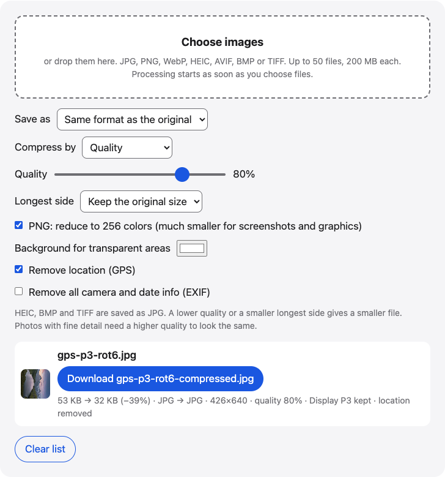

# PicWay Tools

Browser tools for photos and videos: compress, convert, resize, crop, blur, add a border, make a collage, and view or change photo metadata. Each tool is a single web page that does its work in your browser.



## Tools

| Tool | What it does | Folder | Online |
|---|---|---|---|
| [Compress images](tools/compress-image/) | Make images smaller, by quality or a target size. | `tools/compress-image/` | [picway.app/tools/compress-image](https://picway.app/tools/compress-image/) |
| [HEIC to JPG](tools/heic-to-jpg/) | Turn iPhone HEIC photos into JPG or PNG. | `tools/heic-to-jpg/` | [picway.app/tools/heic-to-jpg](https://picway.app/tools/heic-to-jpg/) |
| [Image converter](tools/image-converter/) | Change an image to JPG, PNG, WebP or another format. | `tools/image-converter/` | [picway.app/tools/image-converter](https://picway.app/tools/image-converter/) |
| [Resize images](tools/resize-image/) | Change the width and height in pixels or percent. | `tools/resize-image/` | [picway.app/tools/resize-image](https://picway.app/tools/resize-image/) |
| [Crop image](tools/crop-image/) | Crop, rotate or flip a photo. | `tools/crop-image/` | [picway.app/tools/crop-image](https://picway.app/tools/crop-image/) |
| [Blur image](tools/blur-image/) | Pixelate, blur or black out part of a photo. | `tools/blur-image/` | [picway.app/tools/blur-image](https://picway.app/tools/blur-image/) |
| [Photo border](tools/photo-border/) | Add a border, or make a photo square without cropping. | `tools/photo-border/` | [picway.app/tools/photo-border](https://picway.app/tools/photo-border/) |
| [Photo collage](tools/photo-collage/) | Put several photos into one image or one long strip. | `tools/photo-collage/` | [picway.app/tools/photo-collage](https://picway.app/tools/photo-collage/) |
| [Edit photo metadata](tools/edit-photo-metadata/) | Change a photo’s date, time or location. | `tools/edit-photo-metadata/` | [picway.app/tools/edit-photo-metadata](https://picway.app/tools/edit-photo-metadata/) |
| [Remove photo location](tools/remove-photo-location/) | Take the GPS location out of a photo before you share it. | `tools/remove-photo-location/` | [picway.app/tools/remove-photo-location](https://picway.app/tools/remove-photo-location/) |
| [Compress video](tools/compress-video/) | Make a video smaller to send or share. | `tools/compress-video/` | [picway.app/tools/compress-video](https://picway.app/tools/compress-video/) |
| [MOV to MP4](tools/mov-to-mp4/) | Turn a MOV video into an MP4. | `tools/mov-to-mp4/` | [picway.app/tools/mov-to-mp4](https://picway.app/tools/mov-to-mp4/) |
| [Video to GIF](tools/video-to-gif/) | Turn part of a video into an animated GIF. | `tools/video-to-gif/` | [picway.app/tools/video-to-gif](https://picway.app/tools/video-to-gif/) |
| [GIF to MP4](tools/gif-to-mp4/) | Turn an animated GIF into an MP4 video. | `tools/gif-to-mp4/` | [picway.app/tools/gif-to-mp4](https://picway.app/tools/gif-to-mp4/) |

Each folder has its own README with steps, formats and limits.

## Run it on your computer

You need Node.js 22.6 or later.

```sh
git clone https://github.com/picwayapp/picway-tools.git
cd picway-tools
npm ci
npm run dev
```

Open the address it prints (usually http://localhost:5173/) and pick a tool. To build static files instead, run `npm run build`; the pages are written to `dist/`, and any static file server can host them.

## Where your files go

The file is read and processed inside the page, in your browser, and these pages have no server that receives it. One tool also talks to OpenStreetMap: in Edit photo metadata, a place name you search for is sent to OpenStreetMap’s Nominatim service, and showing the map requests map tiles around the pin from tile.openstreetmap.org.

## Browser support

The video tools use WebCodecs, the video encoders and decoders built into the browser. They need Safari on iPhone with iOS 16.4 or later, or an up-to-date Chrome or Edge on a computer. On iPhone and iPad the size limits are lower, because the result is held in memory; each tool’s README lists its limits.

## How the code is organized

```
packages/core/   processing code shared by the tools (decode, encode, EXIF and GPS, MP4, GIF, ZIP)
tools/<name>/    one tool: index.html, main.ts (the page), strings.ts (UI text), README.md
web/             shared page style and the script that loads each tool
tests/           unit tests (node --test) and a browser test (Playwright)
extensions/      browser extensions (coming soon)
```

Adding a tool means adding a folder under `tools/` with an `index.html` and a `main.ts` that exports `mount(element)`. The build and the start page pick it up from the folder.

The UI text is in English, with Simplified Chinese, Traditional Chinese and Japanese strings in the code; a page uses the language set in its `data-lang` attribute.

## Tests

```sh
npm test                       # unit tests for the processing code
npm run build
npm run test:browser           # opens every tool page, feeds it a sample file, checks the download
npm run test:browser -- --browser webkit --only compress-video,video-to-gif,gif-to-mp4
```

The browser test uses `playwright-core`; install its browsers with `npx playwright-core install chromium webkit`. Playwright’s Chromium has no H.264 decoder, so run the video tools with WebKit. Sample files in `tests/fixtures/` are synthetic test images and clips.

## About PicWay

These tools are made by [PicWay](https://picway.app/), an iPhone app for sorting your photo library. PicWay isn’t on the App Store yet.

- **Swipe to sort.** Swipe left or right on each photo to decide what stays.
- **Just your life photos.** The Life view sets screenshots, screen recordings and animated images aside. Anything it isn’t sure about stays in the view.
- **And more.** Cut a section out of a video or change its speed part by part, make your own filters, convert formats, sort similar and duplicate photos, and search your library.

## License

MIT, see [LICENSE](LICENSE). The tools use open-source libraries under their own licenses; see [THIRD_PARTY_NOTICES.md](THIRD_PARTY_NOTICES.md).
