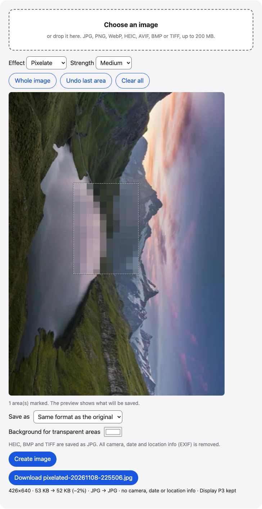

# Blur image

Blur, pixelate or black out faces, names and license plates in JPG, PNG, WebP and iPhone HEIC photos, right in your browser. All EXIF is removed.

**Use it online:** https://picway.app/tools/blur-image/



## How to use it

1. **Choose an image.** Choose one image with the box at the top of the page, or drop it on it. JPG, PNG, WebP, HEIC, AVIF, BMP and TIFF files all work.
2. **Mark what to hide.** Drag across each part you want to hide. You can mark several areas, or tap Whole image. Pick Pixelate, Blur or Black box; for Pixelate and Blur, also pick a strength.
3. **Create and download.** Check the preview: it shows what will be saved. Tap Create image, then tap Download.

## Details

### Pixelate, blur or black out

Choose one image and it opens in the editor. Drag across a face, a name or a number to mark it. The preview changes right away and shows exactly what will be saved.

- **Several areas**: mark as many as you need. **Undo last area** removes the last one and **Clear all** removes them all.
- **Whole image**: covers the entire picture with one area.
- **Effect and Strength**: Pixelate or Blur at Light, Medium or Strong, or Black box, which is always solid black. The effect applies to every area you marked.

Nothing is saved until you tap **Create image**. If you change anything after that, the old download disappears so you never save a version you no longer see.

### What stays and what changes

Only the areas you marked are edited. If the original has a Display P3 color profile, it is kept in JPG, PNG and WebP results. HEIC, BMP and TIFF files are saved as JPG, and all EXIF is removed, including the location. The downloaded file doesn’t carry the original file name: it’s named pixelated, blurred or redacted plus the date and time, such as pixelated-20261109-153012.jpg.

## Privacy

This web tool has no server that receives the image file: it is opened, edited and saved inside this browser tab.

## Run it locally

From the repository root:

```sh
npm ci
npm run dev
```

Then open `http://localhost:5173/tools/blur-image/`. To build static files instead, run `npm run build` and serve the `dist/` folder.

The page script is [`main.ts`](main.ts); the processing code it uses lives in [`packages/core`](../../packages/core).

## About PicWay

This tool is made by PicWay, an iPhone app for sorting photos. PicWay isn’t on the App Store yet. [More about PicWay](../../README.md#about-picway).

## License

MIT. See [LICENSE](../../LICENSE) and [THIRD_PARTY_NOTICES.md](../../THIRD_PARTY_NOTICES.md).
