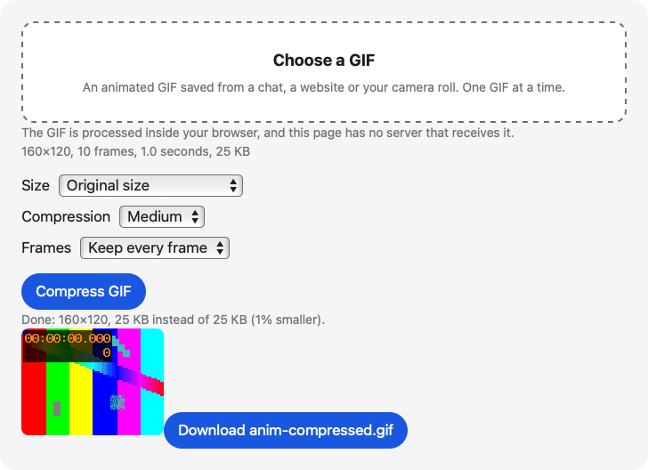

# Compress GIF

Make an animated GIF smaller in your browser. Choose light, medium or heavy compression, a smaller size or fewer frames; it loops just like the original.

**Use it online:** https://picway.app/tools/compress-gif/



## How to use it

1. **Choose the GIF.** Tap the box above and pick a GIF. The page shows its size in pixels, how many frames it has, how long it runs and how big the file is.
2. **Pick the settings.** Choose Light, Medium or Heavy compression, a size, and whether to keep every frame or only 1 frame in 2 or 3.
3. **Compress and download.** Press Compress GIF and keep the tab open. The page shows the new GIF and its file size next to the original’s, then offers it to download.

## Details

### What the settings do

**Compression** chooses Light, Medium or Heavy: up to 256, 128 or 64 colors per frame, with small color changes between frames left undrawn at every level, more so at Medium and Heavy. **Size** keeps the GIF’s own size or sets the longer side to 640, 480 or 320 pixels, without ever making the GIF bigger. **Frames** keeps every frame, or 1 frame in 2 or 3, with the skipped frames’ time added to the frames you keep. Changing any of them clears the GIF you made before.

### Limits to know about

One GIF at a time. iPhone and iPad read GIFs up to 100 MB, and computers up to 500 MB. A GIF can have at most 4096 × 4096 pixels in total (about 16.8 million). If the new GIF wouldn’t be smaller than the original, there is nothing to download. A large GIF takes a while, so keep the tab open.

## Privacy

The GIF is read and compressed by your browser, inside this page. This page has no server that receives your GIF.

## Run it locally

From the repository root:

```sh
npm ci
npm run dev
```

Then open `http://localhost:5173/tools/compress-gif/`. To build static files instead, run `npm run build` and serve the `dist/` folder.

The page script is [`main.ts`](main.ts); the processing code it uses lives in [`packages/core`](../../packages/core).

## About PicWay

This tool is made by PicWay, an iPhone app for sorting photos. PicWay isn’t on the App Store yet. [More about PicWay](../../README.md#about-picway).

## License

MIT. See [LICENSE](../../LICENSE) and [THIRD_PARTY_NOTICES.md](../../THIRD_PARTY_NOTICES.md).
