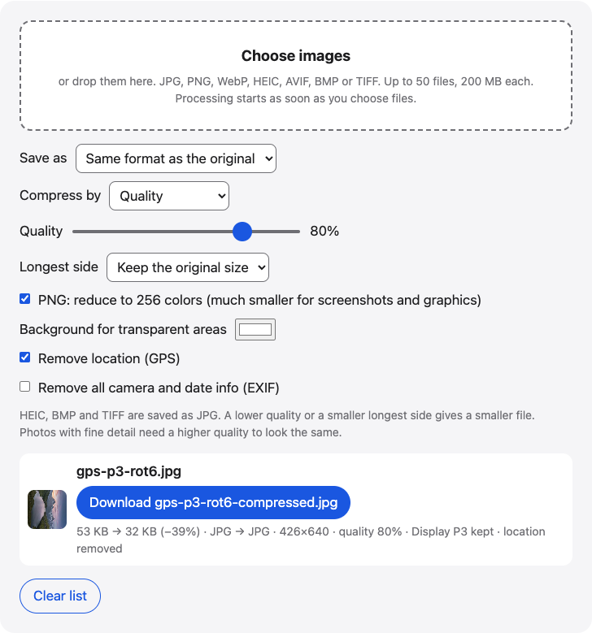

# Compress images

Compress JPG, PNG, WebP and iPhone HEIC photos in your browser. Set a quality or a target size such as 500 KB, cap the longest side, and download the files.

**Use it online:** https://picway.app/tools/compress-image/



## How to use it

1. **Choose your images.** Choose up to 50 images with the box at the top of the page, or drop them on it. JPG, PNG, WebP, HEIC, AVIF, BMP and TIFF files all work.
2. **Pick how much to compress.** Under “Compress by”, choose Quality and move the slider, or choose Target file size and type a size such as 500 KB. To make the pixel size smaller too, pick a value under “Longest side”.
3. **Download.** Each row shows the old and new size. Download each file, or take them all in one ZIP.

## Details

### Quality or target size

There are two ways to say how small you want the file.

- **Quality** is the quick way. The slider starts at 80%, and every JPG, WebP and AVIF image is compressed at the level you set. Sizes differ from image to image, because a busy photo needs more data than a plain one.
- **Target file size** is for upload forms and email limits that say “under 500 KB” or “no more than 2 MB”. The tool tries several quality levels for each image and keeps the best one that fits. When the lowest quality is still too big, it shrinks the pixel size as well.

Both work with **Longest side**. Capping a large photo at 2048 or 1600 pixels can cut its size a lot.

### PNG files

PNG has no quality setting. To make a PNG smaller, the tool reduces it to 256 colors by default. Screenshots, logos and drawings use few colors, and they usually shrink a lot this way. A photo saved as PNG has many more colors, and 256 colors can show banding, so save photos as JPG or WebP instead. If 256 colors is not the smallest result, the tool keeps the smaller version.

### What stays and what changes

Rotated photos come out upright. A Display P3 color profile is kept in JPG, PNG and WebP results. The location is removed by default. The rest of the EXIF, such as camera and date info, stays in JPG, PNG and WebP results unless you turn on **Remove all camera and date info**. HEIC, BMP and TIFF files are saved as JPG.

### Limits

You can add up to 50 images at a time, up to 200 MB each. GIF files are not compressed here. On iPhone and iPad, very large images are scaled down to fit the device’s memory, and the row says so.

## Privacy

This web tool has no server that receives the image file: it is opened and compressed inside this browser tab.

## Run it locally

From the repository root:

```sh
npm ci
npm run dev
```

Then open `http://localhost:5173/tools/compress-image/`. To build static files instead, run `npm run build` and serve the `dist/` folder.

The page script is [`main.ts`](main.ts); the processing code it uses lives in [`packages/core`](../../packages/core).

## About PicWay

This tool is made by PicWay, an iPhone app for sorting photos. PicWay isn’t on the App Store yet. [More about PicWay](../../README.md#about-picway).

## License

MIT. See [LICENSE](../../LICENSE) and [THIRD_PARTY_NOTICES.md](../../THIRD_PARTY_NOTICES.md).
