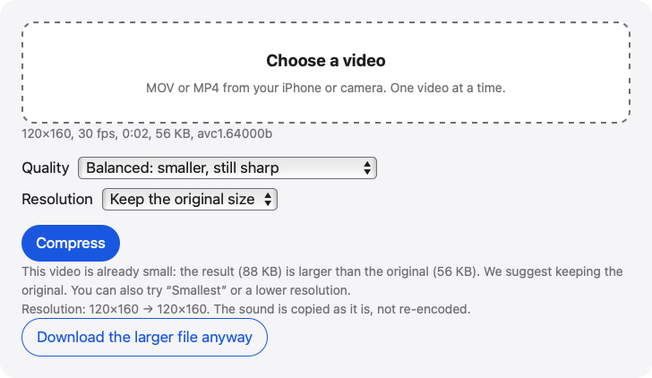

# Compress video

A video compressor in your browser. Pick an iPhone video, Balanced or Smallest and a maximum resolution, and it re-encodes to MP4, usually smaller.

**Use it online:** https://picway.app/tools/compress-video/



## How to use it

1. **Choose the video.** Tap the box at the top of the page and pick a MOV or MP4 from your iPhone or camera. Once it reads the file, the page shows its size, resolution, frame rate and format.
2. **Pick the settings.** Balanced keeps the picture sharp. Smallest suits chat and email. Choose the 1080p option (long side up to 1920 pixels) or the 720p option (up to 1280 pixels) to shrink it further.
3. **Compress and download.** Press Compress and keep the tab open until it finishes. Then download the MP4.

## Details

### What the settings do

**Balanced** targets a bitrate below the original, with a minimum so the picture keeps its detail (a very small video can still come out larger). **Smallest** cuts the bitrate further. **Resolution** can limit the long side to 1920 pixels (the 1080p option) or 1280 pixels (the 720p option). The picture is scaled down in proportion and never scaled up, so a video already within the limit isn’t resized. For a 16:9 landscape video that means at most 1920 × 1080 or 1280 × 720; for other shapes, go by the size the result shows. The picture’s rotation is kept, so a portrait iPhone video stays upright.

### Limits to know about

One video at a time. iPhone and iPad accept up to 300 MB, and computers up to 2 GB. A 4K video takes a while, because the device is doing the encoding, so keep the tab open. An HDR video is encoded as a standard 8-bit video. If the page says it can’t compress in your browser, try Safari on iPhone with iOS 16.4 or later, or an up-to-date Chrome or Edge on a computer.

## Privacy

The video is read and re-encoded by your browser, inside this page. This page has no server that receives your video.

## Run it locally

From the repository root:

```sh
npm ci
npm run dev
```

Then open http://localhost:5173/tools/compress-video/. To build static files instead, run `npm run build` and serve the `dist/` folder.

The page script is [`main.ts`](main.ts); the processing code it uses lives in [`packages/core`](../../packages/core).

## About PicWay

This tool is made by PicWay, an iPhone app for sorting photos. PicWay isn’t on the App Store yet. [More about PicWay](../../README.md#about-picway).

## License

MIT. See [LICENSE](../../LICENSE) and [THIRD_PARTY_NOTICES.md](../../THIRD_PARTY_NOTICES.md).
