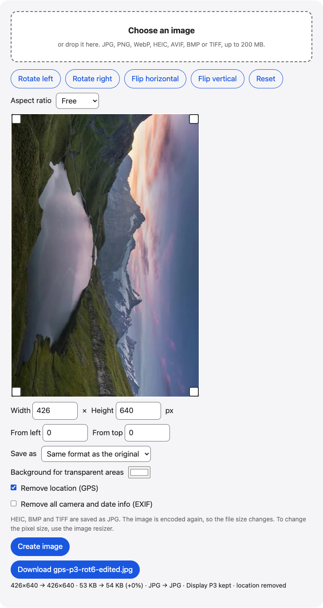

# Crop image

Crop JPG, PNG, WebP and iPhone HEIC photos in your browser. Drag the crop box or pick a ratio such as 1:1 or 16:9, rotate 90°, flip, and download.

**Use it online:** https://picway.app/tools/crop-image/



## How to use it

1. **Choose an image.** Choose one image with the box at the top of the page, or drop it on it. JPG, PNG, WebP, HEIC, AVIF, BMP and TIFF files all work.
2. **Crop, rotate or flip.** Drag the crop box, or drag a corner to resize it. Pick a ratio such as 1:1 or 16:9, or type the width and height in pixels. Use Rotate left, Rotate right, Flip horizontal and Flip vertical to turn the picture.
3. **Create and download.** Tap Create image. A Download button appears, with the old and new size in pixels and in bytes.

## Details

### Crop, rotate and flip

Choose one image and it opens in the editor with the crop box around the whole picture.

- **Crop**: drag the box to move it, or drag a corner to change its size. The arrow keys move it one pixel at a time, or ten with Shift. Pick a ratio such as 1:1, 4:5 or 16:9 for a common shape, or type the size in pixels.
- **Rotate**: Rotate left and Rotate right turn the picture 90 degrees.
- **Flip**: Flip horizontal mirrors it left to right; Flip vertical mirrors it top to bottom.
- **Reset** undoes rotations and flips, puts the crop box back around the whole picture and sets the ratio back to Free.

Nothing is saved until you tap **Create image**. If you change anything after that, the old download disappears so you never save a version you no longer see.

### What stays and what changes

Photos taken sideways open upright. If the original has a Display P3 color profile, it is kept in JPG, PNG and WebP results. The location is removed by default, and **Remove all camera and date info** clears the rest of the EXIF. HEIC, BMP and TIFF files are saved as JPG. The result shows the old and new size in pixels and in bytes. Its name ends in -cropped if you cropped it (even when you also rotated or flipped it), otherwise in -rotated or -flipped, or in -edited when the picture was not cropped, rotated or flipped (for example when you only change the format).

## Privacy

This web tool has no server that receives the image file: it is opened, cropped and saved inside this browser tab.

## Run it locally

From the repository root:

```sh
npm ci
npm run dev
```

Then open http://localhost:5173/tools/crop-image/. To build static files instead, run `npm run build` and serve the `dist/` folder.

The page script is [`main.ts`](main.ts); the processing code it uses lives in [`packages/core`](../../packages/core).

## About PicWay

This tool is made by PicWay, an iPhone app for sorting photos. PicWay isn’t on the App Store yet. [More about PicWay](../../README.md#about-picway).

## License

MIT. See [LICENSE](../../LICENSE) and [THIRD_PARTY_NOTICES.md](../../THIRD_PARTY_NOTICES.md).
