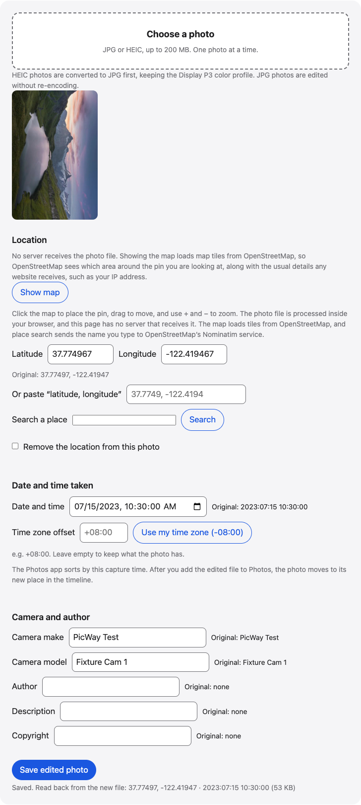

# Edit photo metadata

View a photo’s metadata in your browser, then change its GPS location, date and time taken, time zone or camera fields if you need to, and save a new JPG.

**Use it online:** https://picway.app/tools/edit-photo-metadata/



## How to use it

1. **Choose the photo.** Pick a JPG or HEIC photo. The page reads its location, date, time zone and camera fields and shows them as the original values.
2. **Change what you need.** Click the map, search for a place or type coordinates. Set a new date and time. The time zone is optional. Edit the camera, author or description if you want.
3. **Save the new photo.** Save the edited photo. The page reads the new file back and shows the location and date it now holds.

## Details

### Change a photo’s date, time and GPS location

Choose the photo, type a new date and time (the time zone is optional), then click the map or type coordinates to set a new GPS location. The original values are shown next to each field. When you save, you get a new copy of the photo with your changes.

### What you can change

The tool edits the info stored inside the photo file: the GPS position, the date and time taken, the time zone offset, and text fields such as author, description and copyright. It shows the original value next to each field, so you can see what you are replacing. The tool writes the EXIF fields you changed into a new copy. When you add, change or remove the location, it also removes the photo’s XMP/IPTC data so the old location can’t linger; that data may hold author, description or copyright details, so keep the original file if you need them, and decide before you save. A JPG photo is edited without re-encoding, so the picture is untouched. A HEIC photo is converted to JPG first, keeping its Display P3 color profile, and then the info is written.

### Pick a location

Click the map to drop the pin where the photo should say it was taken. You can drag the map to move around and use + and − to zoom. You can also search for a place by name, type latitude and longitude, or paste a pair like `37.7749, -122.4194`. Tick “Remove the location from this photo” if you want no location at all.

### Change the date and time

The date and time you set is written as the date taken (the original and digitized times), and the modification time inside the photo info is set to match. The time zone offset is optional. Leave it empty to keep what the photo has, or press the button to use your own time zone. If you move the photo to a different time, the Photos app on iPhone files it under the new date once you add the edited file.

### Limits

One photo at a time, up to 200 MB. For a JPG, the edit changes the info stored in the file only; a HEIC photo is saved as a new JPG. It can’t change info that an app keeps outside the file. Editing a date or place to misrepresent when or where something happened can mislead people. Use it to correct honest mistakes, like a camera clock set to the wrong time zone.

## Privacy

The photo file is processed inside your browser, and this page has no server that receives it. If you search for a place, the name you type is sent to OpenStreetMap’s Nominatim service. Showing the map requests map tiles around the pin from OpenStreetMap’s tile server (tile.openstreetmap.org), which tells it that approximate location.

## Run it locally

From the repository root:

```sh
npm ci
npm run dev
```

Then open `http://localhost:5173/tools/edit-photo-metadata/`. To build static files instead, run `npm run build` and serve the `dist/` folder.

The page script is [`main.ts`](main.ts); the processing code it uses lives in [`packages/core`](../../packages/core).

## About PicWay

This tool is made by PicWay, an iPhone app for sorting photos. PicWay isn’t on the App Store yet. [More about PicWay](../../README.md#about-picway).

## License

MIT. See [LICENSE](../../LICENSE) and [THIRD_PARTY_NOTICES.md](../../THIRD_PARTY_NOTICES.md).
