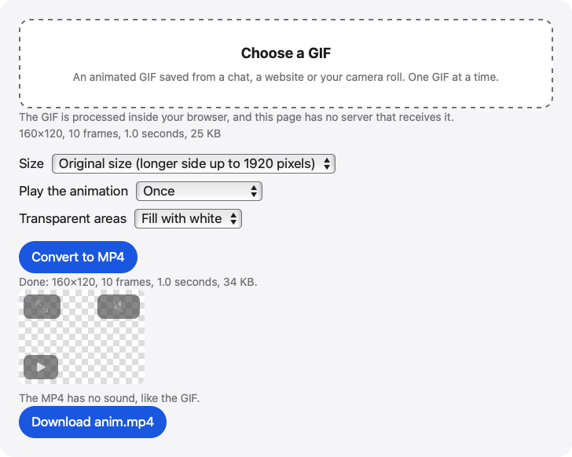

# GIF to MP4

Turn an animated GIF into an MP4 video in your browser, timed as browsers play it. Pick a size, how many times it plays and a fill for transparent areas.

**Use it online:** https://picway.app/tools/gif-to-mp4/



## How to use it

1. **Choose the GIF.** Tap the box at the top of the page and pick an animated GIF. The page shows its size in pixels, how many frames it has, how long it runs and how big the file is.
2. **Pick the settings.** Choose a size, how many times in a row the animation plays (once, or 2, 3, 5 or 10 times) and whether transparent areas are filled with white or black.
3. **Convert and download.** Press Convert to MP4 and keep the tab open. The page shows the video, then offers it to download.

## Details

### What the settings do

**Size** keeps the GIF’s own size (longer side up to 1920 pixels) or sets the longer side to 1080, 720 or 480 pixels, without ever making the GIF bigger. **Play the animation** puts the animation into the video once, or 2, 3, 5 or 10 times in a row. **Transparent areas** chooses whether see-through parts become white or black. Changing any of them clears the video you made before.

### Limits to know about

One GIF at a time. iPhone and iPad read GIFs up to 100 MB, and computers up to 500 MB. A GIF can have at most 4096 × 4096 pixels in total (about 16.8 million), and a video can hold at most 9,000 frames. The page needs a browser with WebCodecs that can make H.264 video. The MP4 has no sound and no transparency. A large GIF played many times takes a while, so keep the tab open.

## Privacy

The GIF is read and turned into a video by your browser, inside this page. This page has no server that receives your GIF.

## Run it locally

From the repository root:

```sh
npm ci
npm run dev
```

Then open `http://localhost:5173/tools/gif-to-mp4/`. To build static files instead, run `npm run build` and serve the `dist/` folder.

The page script is [`main.ts`](main.ts); the processing code it uses lives in [`packages/core`](../../packages/core).

## About PicWay

This tool is made by PicWay, an iPhone app for sorting photos. PicWay isn’t on the App Store yet. [More about PicWay](../../README.md#about-picway).

## License

MIT. See [LICENSE](../../LICENSE) and [THIRD_PARTY_NOTICES.md](../../THIRD_PARTY_NOTICES.md).
