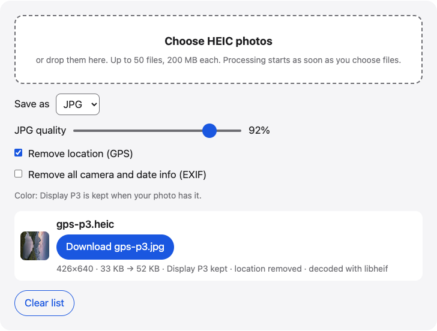

# HEIC to JPG

HEIC to JPG in your browser: convert iPhone HEIC photos to JPG or PNG. It keeps Display P3 color when the photo has it and removes location by default.

**Use it online:** https://picway.app/tools/heic-to-jpg/



## How to use it

1. **Choose your HEIC photos.** Choose up to 50 HEIC photos with the box at the top of the page, or drop them on it.
2. **Pick the settings.** Choose JPG or PNG. Leave “Remove location” on if you plan to share the photos. Turn on “Remove all camera and date info” to remove the camera and date info (EXIF). The color profile stays.
3. **Download.** Download each photo, or take them all in one ZIP.

## Details

### Batch-convert up to 50 HEIC photos to JPG or PNG

Choose up to 50 HEIC photos at once, up to 200 MB each. Each one is converted to JPG (JPEG) or PNG in your browser, on this page. When two or more are done, one button downloads them all as a ZIP. These limits are for this web tool.

### How this HEIC to JPG converter keeps your colors

Many iPhone photos are stored with a Display P3 color profile, which covers more colors than the sRGB that most websites assume. When you convert, this tool reads the profile from the HEIC file and writes it into the JPG or PNG, so the colors match the original on screens and apps that read profiles. If the photo has no profile, the new file has none either, and it shows as sRGB.

In browsers that can decode HEIC themselves, the browser does the decoding. In other browsers the tool loads a decoder the first time you use it.

### What happens to location and EXIF

Photos carry hidden info called EXIF: the capture date, camera, lens, and sometimes the GPS position. The first checkbox, **Remove location**, is on by default. It removes the GPS block and the embedded preview image, and keeps the rest. The second, **Remove all camera and date info**, strips all EXIF. The color profile is kept, because removing it changes how the photo looks.

After each photo, the page tells you whether a location was found and removed.

### Limits

You can add up to 50 photos at a time, up to 200 MB each. Very large photos are shrunk if the browser’s canvas can’t hold them, and the result says so.

## Privacy

No server receives the photo file: it is opened and converted inside this browser tab.

## Run it locally

From the repository root:

```sh
npm ci
npm run dev
```

Then open `http://localhost:5173/tools/heic-to-jpg/`. To build static files instead, run `npm run build` and serve the `dist/` folder.

The page script is [`main.ts`](main.ts); the processing code it uses lives in [`packages/core`](../../packages/core).

## About PicWay

This tool is made by PicWay, an iPhone app for sorting photos. PicWay isn’t on the App Store yet. [More about PicWay](../../README.md#about-picway).

## License

MIT. See [LICENSE](../../LICENSE) and [THIRD_PARTY_NOTICES.md](../../THIRD_PARTY_NOTICES.md).
