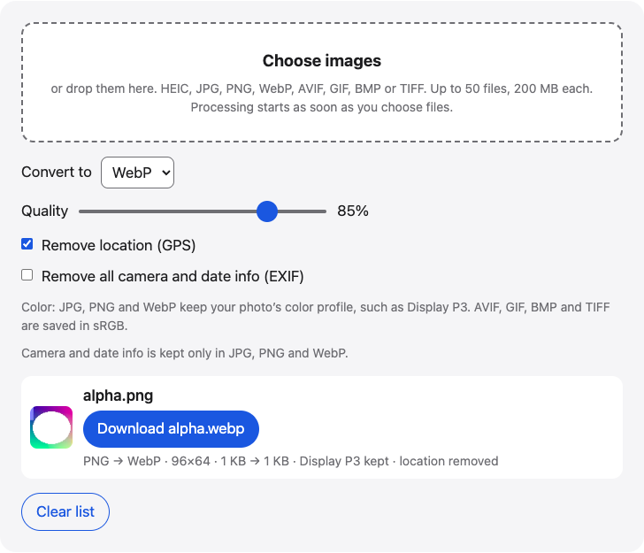

# Image converter

Convert PNG to JPG, WebP to JPG, JPG to PNG, AVIF or HEIC to PNG and more in your browser. Set quality and a background color, then download the new files.

**Use it online:** https://picway.app/tools/image-converter/



## How to use it

1. **Choose your images.** Choose up to 50 images with the box at the top of the page, or drop them on it. HEIC, JPG, PNG, WebP, AVIF, GIF, BMP and TIFF files all work.
2. **Pick the output format and settings.** Choose the format under “Convert to”. For JPG, WebP and AVIF, set the quality. For JPG and BMP, choose the background color for transparent areas. Leave “Remove location” on if you plan to share the images.
3. **Download.** Download each converted image, or take them all in one ZIP.

## Details

### Which format to pick

Different formats are good at different jobs, and the converter lets you move a file between all of them.

- **JPG** is the format that opens everywhere. Use it for photos you will send, print or upload.
- **PNG** keeps sharp edges and transparency. Use it for screenshots, logos, and images with text. A photo saved as PNG is much bigger than the same photo as JPG.
- **WebP** makes smaller files than JPG at a similar look, and every current browser can show it. It is a good choice for images on a web page.
- **AVIF** is usually the smallest of the three. Some older apps cannot open it.
- **GIF** has only 256 colors, so use it for simple graphics, not photos.
- **BMP** and **TIFF** are large, uncompressed formats that some older software and print workflows still ask for.

### Transparent images

Transparency lives in the PNG, WebP, AVIF and TIFF formats, and in GIF as an on/off switch. JPG and BMP cannot hold it. When you convert a transparent image to JPG or BMP, the see-through parts are filled with the background color you choose, white by default. If you need to keep the transparency, save as PNG or WebP.

### Animated files

Animated GIF, WebP and PNG files convert to a single still image: the first frame. The result row tells you when that happened. This tool does not create or convert animations.

### Color and hidden info

Photos can carry a color profile and EXIF data such as the capture date, the camera, and sometimes the GPS location. JPG, PNG and WebP can hold both, so the converter keeps the Display P3 profile there and removes the location by default. **Remove all camera and date info** clears the rest. AVIF, GIF, BMP and TIFF results are saved in sRGB with no camera or date info, so choose JPG, PNG or WebP if you need that kept. Rotated photos come out upright, with the orientation tag reset.

### Limits

You can add up to 50 images at a time, up to 200 MB each. Camera RAW files are not supported, and neither is HEIC as an output format. Very large images are shrunk if the chosen format cannot handle that many pixels, and the result row says so.

## Privacy

This web tool has no server that receives the image file: it is opened and converted inside this browser tab.

## Run it locally

From the repository root:

```sh
npm ci
npm run dev
```

Then open `http://localhost:5173/tools/image-converter/`. To build static files instead, run `npm run build` and serve the `dist/` folder.

The page script is [`main.ts`](main.ts); the processing code it uses lives in [`packages/core`](../../packages/core).

## About PicWay

This tool is made by PicWay, an iPhone app for sorting photos. PicWay isn’t on the App Store yet. [More about PicWay](../../README.md#about-picway).

## License

MIT. See [LICENSE](../../LICENSE) and [THIRD_PARTY_NOTICES.md](../../THIRD_PARTY_NOTICES.md).
