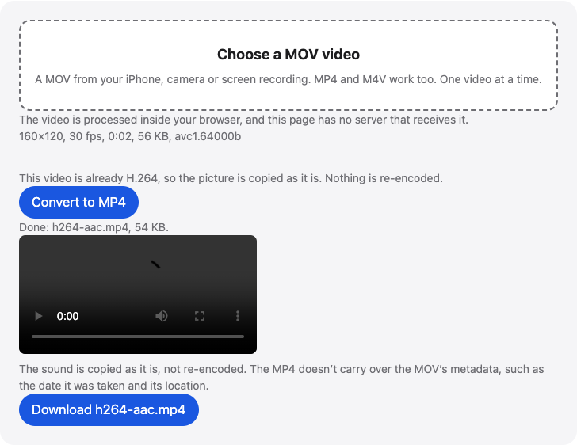

# MOV to MP4

Convert a MOV from your iPhone or camera to MP4 in your browser. H.264 video is copied as it is, and HEVC can be re-encoded to H.264 for wider device support.

**Use it online:** https://picway.app/tools/mov-to-mp4/



## How to use it

1. **Choose the MOV.** Tap the box at the top of the page and pick a MOV from your iPhone, camera or a screen recording. The page shows its size, resolution, frame rate and video format.
2. **Check the video setting.** An H.264 video is copied as it is. For an HEVC video, keep “Re-encode to H.264” so more devices and apps can play it (on iPhone and iPad, the page won’t start it if the new file is estimated to be over 300 MB), or choose “Copy the video as it is” for a fast copy.
3. **Convert and download.** Press Convert to MP4 and keep the tab open. The page checks the new file, then offers the MP4 to download.

## Details

### What the video setting does

**Copy the video as it is** moves the H.264 or HEVC frames into the MP4 without decoding them, so it is fast and the picture isn’t re-encoded. **Re-encode to H.264** decodes each frame and encodes it again as H.264, which more devices and apps can play, including those that support H.264. The page offers the choice only for HEVC videos, in a browser with WebCodecs. An H.264 video is always copied.

### Limits to know about

One video at a time. iPhone and iPad accept up to 300 MB, and computers up to 2 GB. Re-encoding a long or 4K video takes a while, because the device is doing the encoding, so keep the tab open. The MP4 doesn’t keep the MOV’s date and location. Sound that isn’t AAC is left out. On iPhone and iPad, if the new file from re-encoding to H.264 is estimated to be over 300 MB, the page starts on copying and won’t start the re-encode, and it says why.

## Privacy

The video is read and converted by your browser, inside this page. This page has no server that receives your video.

## Run it locally

From the repository root:

```sh
npm ci
npm run dev
```

Then open `http://localhost:5173/tools/mov-to-mp4/`. To build static files instead, run `npm run build` and serve the `dist/` folder.

The page script is [`main.ts`](main.ts); the processing code it uses lives in [`packages/core`](../../packages/core).

## About PicWay

This tool is made by PicWay, an iPhone app for sorting photos. PicWay isn’t on the App Store yet. [More about PicWay](../../README.md#about-picway).

## License

PicWay’s own code is MIT-licensed; see [LICENSE](../../LICENSE). The open-source libraries it uses keep their own licenses; see [THIRD_PARTY_NOTICES.md](../../THIRD_PARTY_NOTICES.md).
