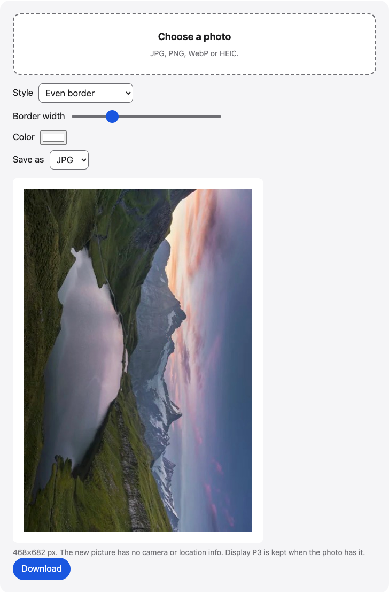

# Photo border

Add a white border, a Polaroid-style card, or pad a photo to a 1:1 or 4:5 frame in your browser. Choose the width and color, then save a JPG or PNG.

**Use it online:** https://picway.app/tools/photo-border/



## How to use it

1. **Choose a photo.** Tap the box at the top of the page and pick a JPG, PNG, WebP or HEIC photo.
2. **Pick a style.** Choose an even border, a Polaroid card with room for a caption, or padding that makes the photo 1:1 or 4:5 without cropping it.
3. **Set the width and color, then download.** Slide the width, pick a color, and save the result as JPG or PNG.

## Details

### Make a photo square without cropping

Choose **Pad to 1:1 square**, or **Pad to 4:5 portrait** for a tall frame. The whole photo stays, and the extra space is filled with the color you pick. The border width sets the minimum margin around the photo.

### Borders for posts and prints

An **even border** adds the same margin on every side. A **Polaroid card** adds narrow margins on three sides and a wide band at the bottom, with room for a caption. **Pad to 1:1** and **Pad to 4:5** put your photo on a square or portrait canvas without cropping it, which helps when an app only accepts those shapes.

### Width and color

Border width is a percentage of the photo’s shorter side, so the same setting looks right on a small and a large photo. White is the classic choice. A cream or black card suits a Polaroid look.

### What stays and what changes

The finished image has no camera or location info, because it is drawn as a new picture.

## Privacy

The photo is read and drawn inside this page, in your browser. This page has no server that receives your photo.

## Run it locally

From the repository root:

```sh
npm ci
npm run dev
```

Then open http://localhost:5173/tools/photo-border/. To build static files instead, run `npm run build` and serve the `dist/` folder.

The page script is [`main.ts`](main.ts); the processing code it uses lives in [`packages/core`](../../packages/core).

## About PicWay

This tool is made by PicWay, an iPhone app for sorting photos. PicWay isn’t on the App Store yet. [More about PicWay](../../README.md#about-picway).

## License

MIT. See [LICENSE](../../LICENSE) and [THIRD_PARTY_NOTICES.md](../../THIRD_PARTY_NOTICES.md).
