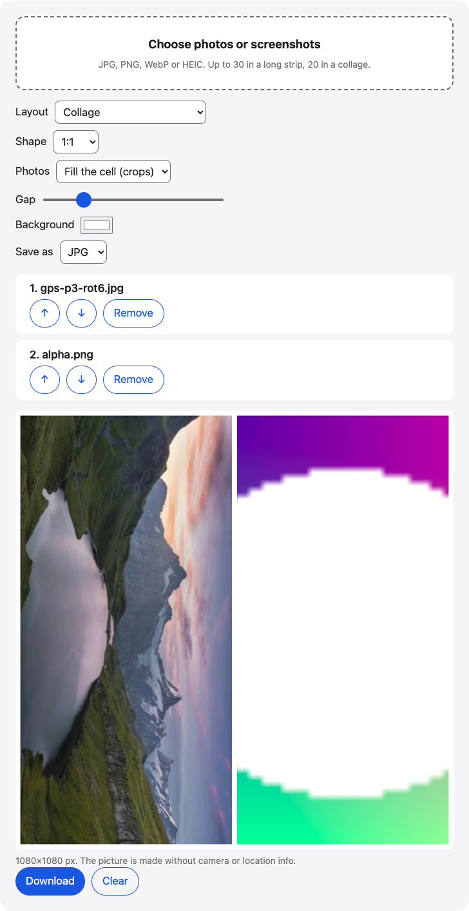

# Photo collage

A collage maker in your browser: combine photos into a collage or stitch screenshots into one long image. Reorder, set the gap and background, then save it.

**Use it online:** https://picway.app/tools/photo-collage/



## How to use it

1. **Add your photos.** Tap the box at the top of the page and pick your photos or screenshots. HEIC photos work too.
2. **Choose a layout.** Pick Collage for a grid in a 1:1, 4:5, 3:4 or 9:16 shape, or Long strip to stack photos from top to bottom. Use the arrows to change the order.
3. **Download.** Check the preview, then download the result as JPG or PNG.

## Details

### Photo collage maker or long strip

**Collage** arranges your photos in a grid inside one picture. Pick the shape (1:1 square, 4:5, 3:4 or 9:16), the gap between photos and the background color. Photos can fill their cell, which crops the edges, or fit whole inside it, which leaves bars of background color.

**Long strip** stacks the photos from top to bottom at one width. It suits chat screenshots, receipts and step-by-step instructions that you want to send as a single image.

### Limits

Up to 20 photos in a collage and 30 in a long strip; JPG, PNG, WebP and HEIC. Collages are drawn at up to 1080 pixels wide, and a long strip is scaled down if it would be larger than about 16 million pixels.

## Privacy

The photos are read and drawn inside this page in your browser. This page has no server that receives your photos.

## Run it locally

From the repository root:

```sh
npm ci
npm run dev
```

Then open http://localhost:5173/tools/photo-collage/. To build static files instead, run `npm run build` and serve the `dist/` folder.

The page script is [`main.ts`](main.ts); the processing code it uses lives in [`packages/core`](../../packages/core).

## About PicWay

This tool is made by PicWay, an iPhone app for sorting photos. PicWay isn’t on the App Store yet. [More about PicWay](../../README.md#about-picway).

## License

MIT. See [LICENSE](../../LICENSE) and [THIRD_PARTY_NOTICES.md](../../THIRD_PARTY_NOTICES.md).
