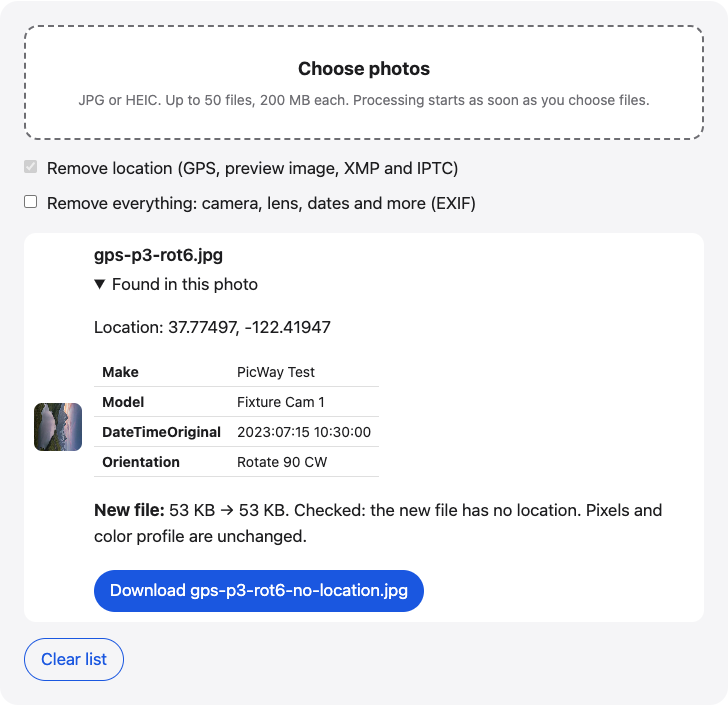

# Remove photo location

A photo metadata remover in your browser: see what a photo reveals, then remove its GPS location, or all EXIF if you choose. JPG files are not re-encoded.

**Use it online:** https://picway.app/tools/remove-photo-location/



## How to use it

1. **Choose your photos.** Tap the box at the top of the page and pick JPG or HEIC photos, or drag and drop them into the box. The page first lists what each photo contains.
2. **Choose what to remove.** “Remove location” is on by default. Turn on “Remove everything” to also drop camera, lens and date info.
3. **Check and download.** Each new file is read again to confirm the location is gone. Then download it, or take everything in one ZIP.

## Details

### What a photo can give away

A photo taken on a phone is more than pixels. The file can carry the exact spot where you took it, the time, the phone model, and the app that last edited it. If you send the original file to someone, they can read all of that. This tool shows it first, so you can decide.

### How the cleaning works

For JPG, the tool finds the metadata blocks in the file and removes or rewrites them. The image data itself is not re-encoded, so the picture and its color profile are unchanged. With “Remove location” on, it removes the GPS block, the small preview image stored in the info, and any XMP or IPTC blocks. Other EXIF fields such as the date and camera stay. With “Remove everything” on, the whole EXIF block goes, but the color profile stays so the colors don’t shift.

After cleaning, the page reads the new file with the same reader it used for the original and checks that no GPS position is left.

### HEIC photos

HEIC photos can’t be rewritten in place here. They are converted to JPG first, and then cleaned. If you only need JPG copies, see the [HEIC to JPG converter](https://picway.app/tools/heic-to-jpg/).

### Limits

Up to 50 photos at a time, 200 MB each. Only JPG and HEIC photos are accepted.

## Privacy

The photo is read and cleaned by your browser, inside this page. This page has no server that receives your photo.

## Run it locally

From the repository root:

```sh
npm ci
npm run dev
```

Then open `http://localhost:5173/tools/remove-photo-location/`. To build static files instead, run `npm run build` and serve the `dist/` folder.

The page script is [`main.ts`](main.ts); the processing code it uses lives in [`packages/core`](../../packages/core).

## About PicWay

This tool is made by PicWay, an iPhone app for sorting photos. PicWay isn’t on the App Store yet. [More about PicWay](../../README.md#about-picway).

## License

PicWay’s own code is MIT-licensed; see [LICENSE](../../LICENSE). The open-source libraries it uses keep their own licenses; see [THIRD_PARTY_NOTICES.md](../../THIRD_PARTY_NOTICES.md).
