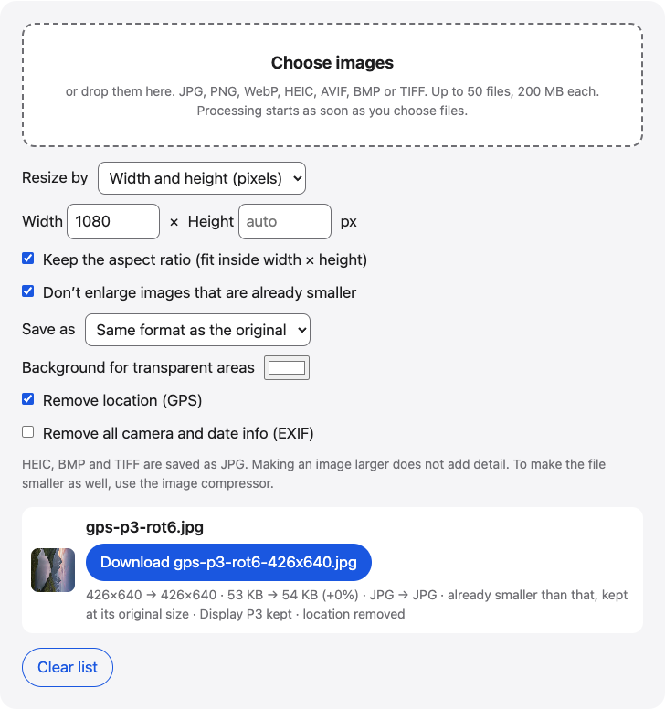

# Resize images

Resize JPG, PNG, WebP, AVIF, BMP, TIFF and HEIC photos in your browser. Set a width and height in pixels or a percentage, keep the aspect ratio, and download.

**Use it online:** https://picway.app/tools/resize-image/



## How to use it

1. **Choose your images.** Choose up to 50 images with the box at the top of the page, or drag and drop them into the box. JPG, PNG, WebP, HEIC, AVIF, BMP and TIFF files all work.
2. **Set the new size.** Type a width, a height or both in pixels, or set “Resize by” to Percentage and type a number such as 50. Leave “Keep the aspect ratio” on so the image is not stretched.
3. **Download.** Each row shows the old and new pixel size. Download each file, or take them all in one ZIP.

## Details

### Pixels or percentage

There are two ways to say how big the new image should be.

- **Width and height** is for a size someone asks for, such as a profile picture, a web page or a form that says “at least 1080 pixels wide”. Type the width, the height or both. With **Keep the aspect ratio** on, the image fits inside the box you typed and is never stretched.
- **Percentage** is for making everything smaller or bigger by the same amount, such as 50% for half the width and half the height.

Every image in the list gets the same setting. With the aspect ratio kept, each image is fitted into the same box, so images of different shapes can come out at different sizes.

### What stays and what changes

Rotated photos come out upright. If the original has a Display P3 color profile, it is kept in JPG, PNG and WebP results, and the row says “Display P3 kept”. The location is removed by default, and **Remove all camera and date info** clears the rest of the EXIF. With “Save as” on Same format as the original, HEIC, BMP and TIFF files are saved as JPG; if you pick PNG or WebP, the files are saved in that format instead. Transparent areas get a background color whenever the result is JPG.

### Limits

You can add up to 50 images at a time, up to 200 MB each. GIF files are not resized here. On iPhone and iPad, very large results are scaled down to fit the device’s memory, and the row says so. Enlarging an image does not add detail.

## Privacy

This web tool has no server that receives the image file: it is opened and resized inside this browser tab.

## Run it locally

From the repository root:

```sh
npm ci
npm run dev
```

Then open `http://localhost:5173/tools/resize-image/`. To build static files instead, run `npm run build` and serve the `dist/` folder.

The page script is [`main.ts`](main.ts); the processing code it uses lives in [`packages/core`](../../packages/core).

## About PicWay

This tool is made by PicWay, an iPhone app for sorting photos. PicWay isn’t on the App Store yet. [More about PicWay](../../README.md#about-picway).

## License

PicWay’s own code is MIT-licensed; see [LICENSE](../../LICENSE). The open-source libraries it uses keep their own licenses; see [THIRD_PARTY_NOTICES.md](../../THIRD_PARTY_NOTICES.md).
