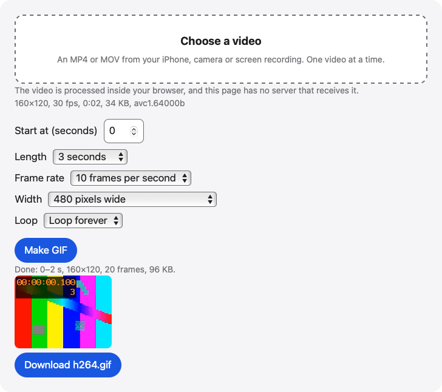

# Video to GIF

Turn part of an MP4 or MOV video into an animated GIF in your browser. Pick the start, length, frame rate and width, then download the finished GIF.

**Use it online:** https://picway.app/tools/video-to-gif/



## How to use it

1. **Choose the video.** Tap the box at the top of the page and pick an MP4 or MOV from your iPhone, camera or a screen recording. The page shows its size, resolution, frame rate, length and video format.
2. **Pick the clip and settings.** Type the second where the GIF should start and choose a length: 2, 3, 5, 8, 10, 15 or 20 seconds. Then pick a frame rate, a width and whether the GIF loops.
3. **Make and download.** Press Make GIF and keep the tab open. The page shows a preview of the GIF, then offers it to download.

## Details

### What the settings do

**Start at** is the second in the video where the GIF begins, and **Length** is how long it runs: 2, 3, 5, 8, 10, 15 or 20 seconds. **Frame rate** is how many pictures the GIF shows each second: 10 is the default, 15 looks smoother and 5 makes a smaller file. **Width** is the GIF’s width in pixels. **Loop** chooses between looping forever and playing once. Changing any of them clears the GIF you made before.

### Limits to know about

One video at a time. A GIF can run up to 20 seconds and 300 frames, and its longer side is at most 800 pixels. iPhone and iPad read videos up to 300 MB, and computers up to 2 GB. The page needs a browser with WebCodecs, and the browser has to be able to decode the video’s format, such as HEVC. A GIF has no sound and at most 256 colors per frame. A long clip at a high frame rate takes a while, so keep the tab open.

## Privacy

The video is read and turned into a GIF by your browser, inside this page. This page has no server that receives your video.

## Run it locally

From the repository root:

```sh
npm ci
npm run dev
```

Then open `http://localhost:5173/tools/video-to-gif/`. To build static files instead, run `npm run build` and serve the `dist/` folder.

The page script is [`main.ts`](main.ts); the processing code it uses lives in [`packages/core`](../../packages/core).

## About PicWay

This tool is made by PicWay, an iPhone app for sorting photos. PicWay isn’t on the App Store yet. [More about PicWay](../../README.md#about-picway).

## License

PicWay’s own code is MIT-licensed; see [LICENSE](../../LICENSE). The open-source libraries it uses keep their own licenses; see [THIRD_PARTY_NOTICES.md](../../THIRD_PARTY_NOTICES.md).
